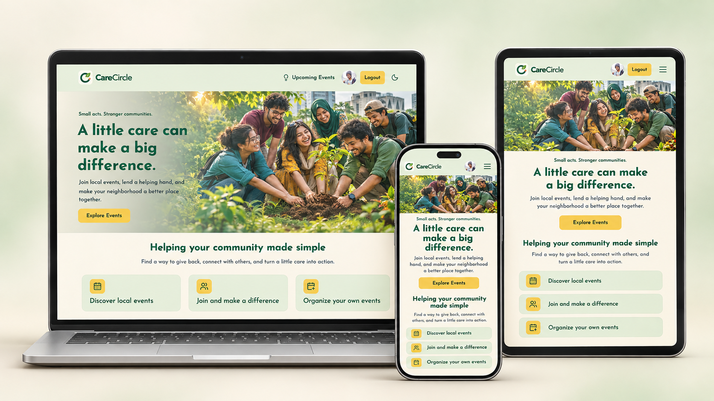
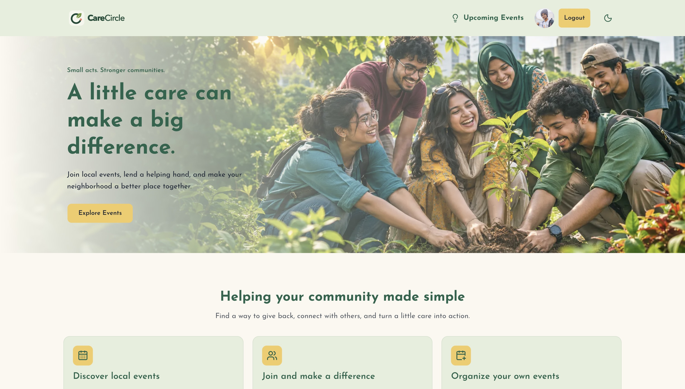

<div align="center">
  

# CareCircle

**Small acts. Stronger communities.**

A community event platform that brings neighbors together to lend a hand, support local causes, and make a positive difference.

### 🌐 [Visit the Live Website](https://carecircle-bondon.vercel.app/)

**Client-side live URL:** https://carecircle-bondon.vercel.app/

[Explore Events](https://carecircle-bondon.vercel.app/upcoming-event) · [Join the Community](https://carecircle-bondon.vercel.app/signup)

</div>

---

## 🌿 About CareCircle

CareCircle helps people discover and participate in community activities—from donation drives and neighborhood cleanups to awareness campaigns and relief efforts. Volunteers can find opportunities to contribute, while organizers can bring people together and manage their events in one place.

## ✨ Website Features

- **Discover upcoming events:** Browse community activities with images, dates, locations, and event categories.
- **View event details:** Learn about an event and its purpose before deciding to participate.
- **Join and leave events:** Sign in to join activities that matter to you, with the option to leave when plans change.
- **Track joined events:** Keep the activities you have joined together on a dedicated page.
- **Create community events:** Organize your own activity with an event title, description, image, date, location, and type.
- **Manage your events:** Edit event information or delete events you have created.
- **Explore past events:** Look back at earlier community activities in the past-events section.
- **Account and profile management:** Register or sign in with email and password or Google, then update your name and profile image.
- **Light and dark themes:** Switch the website’s appearance to suit your preference.
- **Responsive layouts:** Explore the site across mobile, tablet, and desktop screens.

## 💻 Device Mockups

CareCircle on a laptop, mobile phone, and tablet.

[](https://carecircle-bondon.vercel.app/)

*Illustrative device mockups based on the homepage design.*

## 📸 Screenshots

### Homepage

A welcoming introduction to CareCircle and its community mission.



*Homepage screenshot captured from the live website.*

## 💚 Community in Focus


> A little care can make a big difference.

## 🛠️ Built With

| Area | Technologies |
| --- | --- |
| Framework | Next.js, React |
| Language | TypeScript |
| Styling and UI | Tailwind CSS, shadcn/ui, Base UI, Lucide icons |
| Authentication | Better Auth, Google sign-in |
| Authentication storage | MongoDB |
| Themes and notifications | next-themes, Sonner |
| Hosting | Vercel |

## 🚀 Run Locally

Install dependencies and start the development server:

```bash
npm install
npm run dev
```

Configure your local `.env` with the project’s backend URL, MongoDB connection, and authentication settings before running. The event API is a separate service and must be available for event features to work.

Open [http://localhost:3000](http://localhost:3000) to view the application.

```bash
npm run build   # Create a production build
npm start       # Run the production build
npm run lint    # Run ESLint
```

---

<div align="center">

**Built around people. Brought together by care.**

[Explore CareCircle →](https://carecircle-bondon.vercel.app/)

</div>
